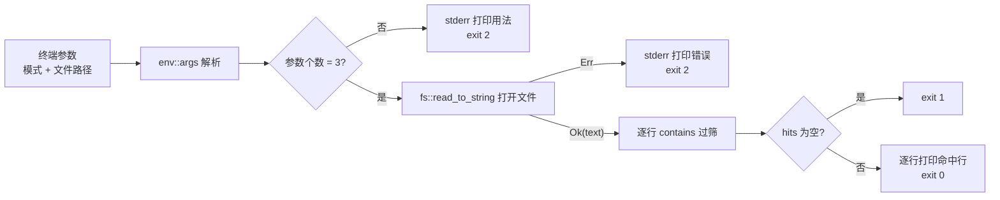

# 用 Rust 造一个自己的 grep：参数、文件、匹配行

凌晨一点。四十万行的日志，你只想要那三行写着 `panic` 的。`grep panic app.log` 敲下去，三秒，答案已经躺在终端里了。这个命令你天天用，可它到底*怎么*知道哪一行该留下？

买现成的工具很容易。真正的匠人不急着买。他把工具拆开看过，知道每一处打磨为什么存在，然后为自己打一把——未必更锋利，但每一寸都懂。

这次我们不打一把新的。我们用 Rust 造一个缩小版的 grep，叫它 **grep-search**：读进一个文件，按行找字面模式，把命中行打印到终端，再复刻 grep 那套古怪却重要的退出码。本部分结束时，你手里会有一把能用的工具——`grep-search <模式> <文件>`——外加一组钉住它行为的测试。

先把话说清楚，我们不贪多。这把工具只做 grep 的一个子集：一次搜一个文件，模式是字面文本（等价于真实 grep 的 `-F` 模式），文件得是 UTF-8 文本。它不是 ripgrep。它是一台你能拆开、看懂、改装的机器——机器和工具的区别，恰恰在于你能不能打开它。

## 你将构建什么

一个名为 `grep-search` 的命令行程序。`cargo run -- berry fruits.txt` 把 `fruits.txt` 里含 `berry` 的每一行原样打印到终端；没有任何命中就安静退出，返回退出码 1；文件不存在或参数给错，报错到 stderr、返回 2；一切顺利返回 0。全程零第三方 crate，只用标准库。

## 前置条件

- Rust 工具链 1.85 或更新。本教程按 **Rust 1.98** 写作，`rustup` 装的稳定版即可，终端里 `cargo --version` 能跑通。
- 一个 Unix 风格终端（macOS、Linux 或 WSL）——检查点里靠 `echo $?` 读退出码。
- 一个文本编辑器。
- 你不需要懂正则。本部分只做字面匹配，正则自有它的章节。

## grep 的契约

动手之前，先回答一个匠人开工前必问的问题：**这件工具，要干的活长什么样？** 一个工具的形状由用途决定——切面包的刀和剔骨刀长得不一样。grep 的答案，有一半刻在它的退出码里。这是它最容易被忽略、却最值得复刻的部分。

| 退出码 | 含义（GNU grep） |
|---|---|
| 0 | 至少有一行被选中（命中） |
| 1 | 没有任何行被选中 |
| 2 | 出错了（文件打不开、参数给错等） |

[GNU grep 手册 "Exit Status"](https://www.gnu.org/software/grep/manual/html_node/Exit-Status.html) 的原话是："0 if a line is selected, 1 if no lines were selected, and 2 if an error occurred"。

我们为什么照抄这套设计，而不是"命中输出 0、没命中随便给个数"？因为 grep 大半辈子活在脚本里，不在指尖下。`grep panic app.log && echo 找到问题了` 靠退出码判断"到底找没找到"——一件命令行工具的契约，一半在 stdout，一半在退出码。忽略后者，这把工具交到脚本手里就是废铁。

> [!ASIDE]
> grep 的名字来自 1973 年 Ken Thompson 给 ed 编辑器写的一个命令：g/re/p——global regular expression print，"全文正则打印"。它太好用，很快独立成了命令，后来又干脆成了动词："grep 一下日志"。（[Wikipedia: Grep](https://en.wikipedia.org/wiki/Grep)）

我们复刻的数据流长这样：



契约定了。图纸摊开，抡锤之前，先备料。

## 脚手架：把项目立起来

在练习目录运行：

```bash
cargo new grep-search
cd grep-search
```

Cargo 搭好了工位：`Cargo.toml` 是料单，`src/main.rs` 是第一件待加工的坯。自 Rust 1.85 起，[`cargo new` 默认生成 edition 2024 的项目](https://doc.rust-lang.org/cargo/commands/cargo-new.html)——你用的是 1.98，料单上应当写着 `edition = "2024"`：

```toml
[package]
name = "grep-search"
version = "0.1.0"
edition = "2024"
```

`src/main.rs` 只有三行问候。先空转一次，确认工位上的每一环都通：

```bash
cargo run
```

预期输出 `Hello, world!`。第一次编译慢一些——rustc 要把标准库编进产物，往后就快了。可执行文件落在 `target/debug/grep-search`。之后每次运行，我们都用 `cargo run -- <参数...>`：`--` 后面的一切原样传给程序，这样带着参数调试，不用先 `cargo build` 再手动找二进制。

## 收下命令行参数

工具接到的第一样东西，来自 [`std::env::args()`](https://doc.rust-lang.org/std/env/fn.args.html)。它返回一个迭代器，里面第 0 项**不是第一个参数，而是程序自己的路径**；真正的参数从下标 1 开始。这里有个新手最容易绊倒的坎，我们先看它怎么绊人：

```rust
fn main() {
    let pattern = env::args().nth(1).unwrap();
    let path = env::args().nth(2).unwrap();
    // 接下来用 pattern 和 path 干活
}
```

这段能编译。能编译的东西，未必经得起用。

**坑一：** `nth` 返回的是 `Option<String>`——没有第 N 个参数时是 `None`，`unwrap` 直接让程序 panic。试试 `cargo run --`（一个参数都不给）：终端炸出一段 `thread 'main' panicked at ... called Option::unwrap() on a None value`。这不是命令行工具该有的死法。grep 遇到同样的输入，会打印一行用法说明，然后退出码 2。一把工具掉地上就散架，和一把工具知道怎么被收好，是两种品质。

> [!HEADS-UP]
> `env::args()` 不是数组，是迭代器，`args()[0]` 这类直觉不适用。更隐蔽的是下标约定：程序名占了下标 0，所以"第一个参数"是下标 1。忘了这个约定，参数会整体错位一个——工具没坏，是把子握反了。

**坑二：** 我们还要表达"无匹配 → 退出码 1"。一路 `unwrap` 炸下去，程序根本走不到那个判断，退出码就失控了——契约里承诺的 1，你永远没机会交付。

修复：把参数收进 `Vec<String>`，先数个数再动手。把 `src/main.rs` 整体替换为：

```rust
use std::env;
use std::process::ExitCode;

fn main() -> ExitCode {
    let args: Vec<String> = env::args().collect();

    if args.len() != 3 {
        eprintln!("用法：grep-search <字面模式> <文件>");
        return ExitCode::from(2);
    }

    let pattern = args[1].as_str();
    let path = args[2].as_str();

    eprintln!("pattern={pattern}, path={path}"); // 占位：下一节换成真活
    ExitCode::SUCCESS
}
```

逐行看我们做了什么、为什么这么做：

- `env::args().collect()` 把迭代器收进 `Vec<String>`——数个数、按下标取，都有了着落。
- 参数个数不是 3（程序名 + 模式 + 文件）就走错误路径：`eprintln!` 把用法写到 **stderr**（不是 stdout），`ExitCode::from(2)` 让进程带着退出码 2 结束。用法错误在契约表里正属于 2——我们自己定的规矩，自己先守。
- `ExitCode` 是 main 的返回类型：Rust 允许 main 返回它，进程的退出码就是它。`ExitCode::from(2)` 构造"错误"，`ExitCode::SUCCESS` 是 0。
- `args[1].as_str()` 从 `String` 借出 `&str` 视图。为什么多这一步？因为接下来要传给 `read_to_string(path)` 这类函数，它们要的是 `&str` 而不是 `&String`——料的规格，加工前就得对好。

跑一下两种输入：

```bash
cargo run -- berry fruits.txt
cargo run -- ; echo "退出码是 $?"
```

预期：第一次打印 `pattern=berry, path=fruits.txt`（`fruits.txt` 还不存在也没关系，我们还没碰文件）；第二次打印一行用法，然后 `退出码是 2`——panic 没有了。

## 打开文件：第一次握手 Result

读整个文件最直白的方式是 [`std::fs::read_to_string`](https://doc.rust-lang.org/std/fs/fn.read_to_string.html)：

```rust
let text = fs::read_to_string(path);
```

看它的返回类型：`Result<String, io::Error>`。这是 Rust 递给新手的第一个大礼包，值得停下来看仔细——**凡是可能失败的操作，返回值里都带着失败的可能**。编译器逼你处理它。C 语言里"忘了检查返回值"是静默的事故，在这里，它根本过不了编译这一关。

想抄近路的人会写：

```rust
let text = fs::read_to_string(path).expect("读文件失败");
```

`cargo run -- berry missing.txt` 一试，文件不存在 → panic。而契约说：出错要 stderr 报错 + 退出码 2。真实 grep 会打印 `grep: missing.txt: No such file or directory` 然后退出 2——它绝不会炸出一坨 panic 回溯。把 panic 留给程序员的 bug，把可预期的失败留给 `Result`——这是两间不同的房间，别走错门。

修复：match 这个 `Result`，`Err` 分支打印与 grep 同构的消息再退出：

```rust
let text = match fs::read_to_string(path) {
    Ok(text) => text,
    Err(err) => {
        eprintln!("grep-search: {path}: {err}");
        return ExitCode::from(2);
    }
};
```

两个设计点，都是向 grep 学的：

- `{err}` 打印 `io::Error` 的人类可读信息，例如 `No such file or directory (os error 2)`。消息带上工具名和路径，与 grep 的 `grep: <文件>: ...` 同构——出问题时你一眼知道是谁、栽在哪个文件上。报错不报出处，等于给人一把不知道哪松了的工具。
- 文件不存在是 `ErrorKind::NotFound`，权限不足是 `ErrorKind::PermissionDenied`，它们都走同一个分支、同一个退出码 2。要不要把它们分开招呼？那是练习 3 的活。

把 `src/main.rs` 更新为：

```rust
use std::env;
use std::fs;
use std::process::ExitCode;

fn main() -> ExitCode {
    let args: Vec<String> = env::args().collect();

    if args.len() != 3 {
        eprintln!("用法：grep-search <字面模式> <文件>");
        return ExitCode::from(2);
    }

    let pattern = args[1].as_str();
    let path = args[2].as_str();

    let text = match fs::read_to_string(path) {
        Ok(text) => text,
        Err(err) => {
            eprintln!("grep-search: {path}: {err}");
            return ExitCode::from(2);
        }
    };

    eprintln!("已读入 {} 字节", text.len()); // 占位：下一节换成真活
    ExitCode::SUCCESS
}
```

现在备一块练习用的料，后面几节都拿它练手：

```bash
printf 'apple\napricot\nbanana\nblueberry\ncherry\n' > fruits.txt
```

跑 `cargo run -- berry fruits.txt`：预期打印 `已读入 38 字节`——5 个水果名共 33 个字母，加 5 个换行符，ASCII 下每个字符恰好 1 字节。再跑 `cargo run -- berry missing.txt`：预期 stderr 出现 `grep-search: missing.txt: No such file or directory (os error 2)`，退出码 2。

> [!NOTE]
> `read_to_string` 要求文件是合法 UTF-8，遇到非法字节会报 `stream did not contain valid UTF-8`。真实 grep 是逐字节工作的，什么文件都敢读。这是我们的刻意取舍——先跟文本打交道，字节级的粗野留给后面的部分。

> [!DESIGN-NOTE]
> **为什么先整读文件，而不是像 grep 那样流式逐行读？**
> 真实 grep 从不把整个文件搬进内存：它打开文件后一条条读、一条条判、一条条写，内存占用恒定。我们用 `read_to_string` 整读，四十万行的日志没问题（约几十 MB），但换个 4 GB 的文件就会吃瘪。
> 这是刻意的教学顺序，不是偷懒。整读换来一个不可否认的好处：`text.lines()` 拿到的是干净利落的切片迭代器，所有注意力都放在"匹配"这一个概念上，不用同时操心"缓冲没满、行被截断、IO 出错怎么办"三件事。等匹配逻辑稳了，再换成流式——到那时你会庆幸错误处理已经铺好轨道：`File` 逐行读遇到的 `io::Error`，和今天 `read_to_string` 返回的是同一个类型，处理方式一模一样。先打好地基，再盖二楼。

## 筛出命中行

料在手上了。现在是这件工具的核心动作：逐行过筛，留下含 pattern 的行。`str::lines()` 按换行符把文本切成行（行尾的 `\n` 不算进内容），[`str::contains`](https://doc.rust-lang.org/std/primitive.str.html#method.contains) 做子串判断。

把"过筛"抽成一个独立函数——它只吃文本和模式、吐回命中行，不碰终端也不碰文件。这样的函数叫**纯函数**：同样的输入，永远同样的输出。它是后面测试的完美靶子，也是我们把"筛"和"用"分开的接缝：

```rust
fn matching_lines(text: &str, pattern: &str) -> Vec<String> {
    let mut hits = Vec::new();

    for line in text.lines() {
        if line.contains(pattern) {
            hits.push(line.to_string());
        }
    }

    hits
}
```

几个行为细节，先讲清楚再动手。筛子的孔多大，得先定好：

- `contains` 是**大小写敏感**的子串匹配：`"Blueberry".contains("berry")` 为真，`"Blueberry".contains("Blue")` 也为真，但 `"blueberry".contains("Berry")` 为假。grep 默认也敏感（`-i` 才忽略大小写），我们跟它一致。
- 空模式 `""`：`contains("")` 恒为真，所以每一行都命中。真实 grep 对空模式同样输出所有行。
- 每次 `to_string()` 都复制一行，浪费但直白。零拷贝地返回"指向原文的切片"需要生命周期标注，那是后面部分的话题——先求能跑、可测、讲得清。

在 `main` 里调用它并打印：

```rust
    let hits = matching_lines(&text, pattern);

    for line in &hits {
        println!("{line}");
    }
```

`for line in &hits` 是**借用**迭代——`hits` 还在，后面还能用它判断空不空；若写 `for line in hits` 就把 `Vec` 消费掉了。这是 Rust 所有权在日常中最常见的形态：借来读，不搬走。搬走一个还在用的东西，编译器会拦你——这是它的本分。

把 `src/main.rs` 更新为：

```rust
use std::env;
use std::fs;
use std::process::ExitCode;

fn main() -> ExitCode {
    let args: Vec<String> = env::args().collect();

    if args.len() != 3 {
        eprintln!("用法：grep-search <字面模式> <文件>");
        return ExitCode::from(2);
    }

    let pattern = args[1].as_str();
    let path = args[2].as_str();

    let text = match fs::read_to_string(path) {
        Ok(text) => text,
        Err(err) => {
            eprintln!("grep-search: {path}: {err}");
            return ExitCode::from(2);
        }
    };

    let hits = matching_lines(&text, pattern);

    for line in &hits {
        println!("{line}");
    }

    if hits.is_empty() {
        ExitCode::from(1)
    } else {
        ExitCode::SUCCESS
    }
}

fn matching_lines(text: &str, pattern: &str) -> Vec<String> {
    let mut hits = Vec::new();

    for line in text.lines() {
        if line.contains(pattern) {
            hits.push(line.to_string());
        }
    }

    hits
}
```

注意 `if hits.is_empty() { ExitCode::from(1) } else { ExitCode::SUCCESS }` 是 main 的**最后一个表达式**——它的值就是返回值。到这里，契约表上的三个刻度都刻完了：命中返回 0、无命中返回 1、参数或文件出错在前面已经 `return` 了 2。

跑起来验证两个方向：

```bash
cargo run -- berry fruits.txt
echo "退出码：$?"
```

预期打印 `blueberry`、`退出码：0`。再跑：

```bash
cargo run -- mango fruits.txt
echo "退出码：$?"
```

预期零输出、`退出码：1`。若你机器上有系统 grep，对照一下 `grep mango fruits.txt; echo $?`——同一个 1。

> [!DESIGN-NOTE]
> **为什么"无命中"值得一个专门的退出码？**
> 对人类用户，无命中就是"屏幕上没东西"。对脚本，两者天差地别：`grep panic app.log && kill $(pidof app)` 想表达"日志里有 panic 就重启服务"——如果 grep 无命中时也返回 0，`&&` 右侧每次都会执行，服务会被无差别重启。退出码 1 是 grep 递给脚本世界的"没找到，别往下走"信号。一件工具值不值得信任，看它敢不敢对你说实话：这次没找到，就是没找到，不装成功。这是我们复刻契约的真正原因：工具不只为指尖服务，也为管道和脚本服务。

## 测试：把契约钉进代码

手工跑三条命令能验证今天的行为，但挡不住明天的改动悄悄弄坏它。测试把契约变成可执行的断言——每次 `cargo test`，契约都被重新过一遍。匠人相信手感，但更相信卡尺。

`matching_lines` 是纯函数——不需要文件、不需要终端，是理想的测试对象。在 `src/main.rs` 末尾追加：

```rust
#[cfg(test)]
mod tests {
    use super::matching_lines;

    #[test]
    fn keeps_only_lines_containing_the_pattern() {
        let text = "apple\napricot\nbanana";
        assert_eq!(matching_lines(text, "an"), vec!["banana"]);
    }

    #[test]
    fn returns_nothing_when_no_line_matches() {
        let text = "apple\nbanana";
        assert!(matching_lines(text, "mango").is_empty());
    }

    #[test]
    fn matching_is_case_sensitive() {
        let text = "Apple\napple";
        assert_eq!(matching_lines(text, "apple"), vec!["apple"]);
    }
}
```

三个断言，各守一道关：

- `#[cfg(test)]`——这个模块只在 `cargo test` 时编译，正常 `cargo run` 不带它，零开销。
- `use super::matching_lines`——测试模块里引入外层（`super`）被测的函数。
- `assert_eq!` 比较命中结果与期望；`assert!` 只要求条件为真。

为什么测试选这三条？第一个测"命中"，第二个测"无命中"（退出码 1 的前置），第三个钉住一个**容易悄悄改变的细节**：大小写敏感。哪天有人好心把匹配改成不敏感、却忘了这是行为变更——第三个测试会当场叫停。好心改坏契约的事，卡尺见得多。

运行：

```bash
cargo test
```

预期：`test result: ok. 3 passed`。

## 检查点

> [!PREDICT]
> 运行之前先承诺答案：`fruits.txt` 有 5 行（apple、apricot、banana、blueberry、cherry）。`cargo run -- an fruits.txt` 会打印几行？退出码是几？写下来，再运行对照——预测与结果的落差，比结果本身教得更多。

```bash
cargo run -- berry fruits.txt
echo "退出码：$?"
```

预期输出：

```
blueberry
退出码：0
```

再验证另外两个状态：

```bash
cargo run -- mango fruits.txt
echo "退出码：$?"
```

预期：零输出，`退出码：1`。

```bash
cargo run -- apple missing.txt
echo "退出码：$?"
```

预期：stderr 出现 `grep-search: missing.txt: No such file or directory (os error 2)`，stdout 为空，`退出码：2`。最后 `cargo test` 应报 `3 passed`。

可能的错误：

- `No such file or directory` 报在 `fruits.txt` 上——你不在项目根目录运行，先 `cd grep-search`。
- 编译器抱怨 `edition 2024` 特性不可用——你的 rustc 老于 1.85，`rustup update stable`。
- 退出码不是 1 而是 0——`for` 循环后还残留旧的返回语句，对照上一节完整文件核对。
- 输出带 `pattern=... path=...` 或 `已读入 ... 字节`——占位行没删干净，回看对应小节。

## 接下来

刀打完了。收进鞘里之前，看一眼它还能往哪个方向长：现在的 `grep-search` 能搜一个 UTF-8 文件、报像样的错误、给脚本正确的退出码。真实 grep 的世界要大得多：一次搜整个目录树、从管道读 stdin、正则表达式、彩色高亮、逐字节读取不怕非法 UTF-8。还有一个悬在头顶的问题：我们把整个文件读进了内存——四十万行没问题，四 GB 呢？这些问题里，随便哪个都够撑起下一个部分。想继续时运行 `/lathe 续写 grep-search`，可以带上你最想先解决的那个方向。

在继续之前，用你自己的话回答一个问题：为什么"没有任何命中"要用退出码 1，而不是 0？想想脚本里 `grep panic app.log && echo 出事了` 的 `&&` 何时才执行右侧，以及 `set -e` 的脚本遇到非零退出码会怎样。这不是"是什么"的问题——退出码表上面就有——而是"为什么这么设计"的问题。答得出这一问，你才算真正接过了这把工具，而不只是把它借来用了一下。

## 练习

1. **大小写不敏感搜索。** 给 `matching_lines` 增加第三个参数 `ignore_case: bool`；为真时把 `line` 和 `pattern` 各自 `to_lowercase()` 再 `contains`。先写一个失败的测试（如 `matching_lines("Apple\napricot", "APPLE", true)` 应返回 `["Apple"]`），再改代码让它变绿。注意 `main` 里的调用处要同步补参数。
2. **打印行号。** 让输出变成 `行号: 内容`（如 `4: blueberry`）。提示：`text.lines().enumerate()` 会给每行带上从 0 开始的下标，打印时加 1 对齐人类计数。这离 `grep -n` 只差一步。
3. **区分错误种类。** 现在任何读文件错误都打印同一句话。改成用 `err.kind()` 判断：`ErrorKind::NotFound` 打印 `grep-search: <路径>: 没有这个文件`，其他错误打印原始 `err`。对照 `io::ErrorKind` 的文档看看还有哪些变体。
4. **反向匹配（`grep -v` 的雏形）。** 新写一个 `non_matching_lines`，返回*不*含 pattern 的行；`main` 里加一个开关（比如第一个参数是 `-v` 时）切换两个函数。退出码语义不变：反向匹配"有输出"仍是 0。

## 来源

**grep 行为**

1. [GNU Grep 3.12 手册 — Exit Status](https://www.gnu.org/software/grep/manual/html_node/Exit-Status.html) —— 退出码 0/1/2 语义的权威定义，本部分契约表的依据。
2. [Wikipedia — Grep](https://en.wikipedia.org/wiki/Grep) —— g/re/p 词源与历史。

**Rust 参考**

3. [cargo-new 文档](https://doc.rust-lang.org/cargo/commands/cargo-new.html) —— 自 Rust 1.85 起默认生成 edition 2024 项目。
4. [std::env::args](https://doc.rust-lang.org/std/env/fn.args.html) —— 程序启动参数；下标 0 是程序路径。
5. [std::fs::read_to_string](https://doc.rust-lang.org/std/fs/fn.read_to_string.html) —— 整读 UTF-8 文件，返回 `Result<String, io::Error>`。
6. [std::process::ExitCode](https://doc.rust-lang.org/std/process/struct.ExitCode.html) —— main 的退出码返回类型。
7. [str::lines / str::contains](https://doc.rust-lang.org/std/primitive.str.html) —— 按行切分与子串匹配。
